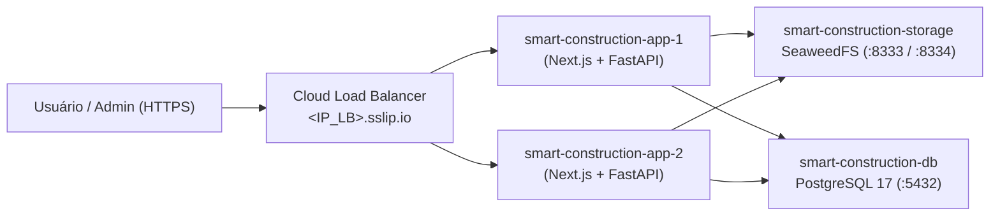

# Arquitetura e Proposta Técnica — Smart Construction (GCP)

## 1. Diagnóstico Inicial do Repositório

O repositório original da aplicação **Smart Construction** foi estruturado para execução local via Docker Compose, composto por:

- **Frontend:** Next.js (`src/app`, `src/features`, `src/infrastructure`).
- **Backend:** FastAPI modular (`backend/`).
- **Banco de Dados:** PostgreSQL 17.
- **Armazenamento de Objetos:** SeaweedFS (buckets editorial e privado).

Na análise inicial, o projeto não possuía infraestrutura como código (IaC), automação de provisionamento, pipelines de deploy contínuo em nuvem, isolamento de rede para dados sensíveis nem estratégia de backup/restore validada.

## 2. Escolha do Provedor e Região

A infraestrutura foi projetada para a **Google Cloud Platform (GCP)** na região **`southamerica-east1`** (São Paulo, zona `southamerica-east1-a`), garantindo baixa latência para usuários no Brasil e aderência ao laboratório acadêmico (`projeto-mensal-4`).

Os principais serviços gerenciados e recursos adotados foram:

- **Compute Engine:** VMs `e2-small` com discos de boot padronizados em `10 GiB` e discos persistentes externos para dados.
- **VPC (`10.10.0.0/24`) + Cloud NAT:** rede privada sem exposição direta das VMs de dados.
- **Identity-Aware Proxy (IAP):** acesso administrativo via SSH sem necessidade de IPs públicos nas VMs.
- **Cloud Load Balancer (HTTPS):** terminação TLS com domínio `<IP_LB>.sslip.io` (ex.: `34.107.193.113.sslip.io`) e health checks.
- **Artifact Registry, Secret Manager e Cloud Storage:** armazenamento de imagens Docker, segredos e state remoto do Terraform.

## 3. Distribuição dos Componentes

Para equilibrar disponibilidade, isolamento de dados e custo acadêmico, a arquitetura foi dividida em **4 VMs**:

1. **`smart-construction-app-1` e `smart-construction-app-2` (`e2-small`, 10 GiB boot):**
   - Executam os containers `web` (Next.js) e `api` (FastAPI) atrás do Cloud Load Balancer.
   - Duas instâncias permitem alta disponibilidade básica e validação de balanceamento de carga.
2. **`smart-construction-storage` (`e2-small`, 10 GiB boot + disco persistente `smart-construction-storage-data-1`):**
   - Centraliza o **SeaweedFS** (`:8333` para ativos editoriais e `:8334` para arquivos privados).
   - **Justificativa:** evita *split-brain* de imagens enviadas pelos usuários entre `app-1` e `app-2`, garantindo que qualquer instância de aplicação leia e grave no mesmo repositório de objetos.
3. **`smart-construction-db` (`e2-small`, 10 GiB boot + disco persistente `smart-construction-db-data-1`):**
   - Executa o **PostgreSQL 17** isolado na VPC (`10.10.0.0/24`), acessível apenas pelas VMs de aplicação.

